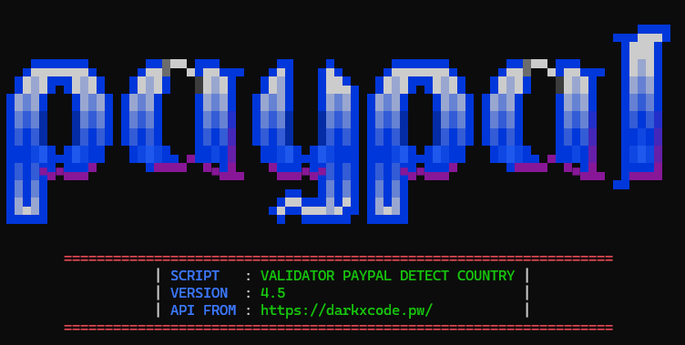
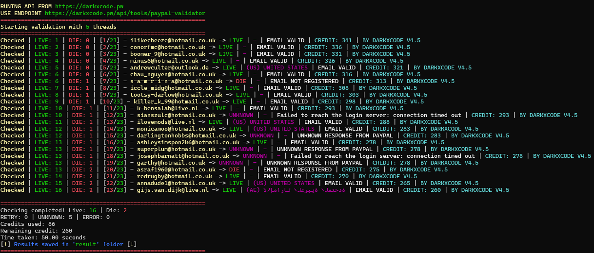

# PAYPAL-VALIDATOR-CLIV4.5
Free PayPal Validator with Detected Country, multithread , fast checking, NEW version And NEW API . CLI Version.

<h1 align="center">
   
  
   
  PAYPAL VALIDATOR EMAIL DETECTED COUNTRY CLI VERSION
   
</h1>

<h4 align="center">This tool can PayPal validation new version</h4>

  
  

 • <a href="https://www.darkxcode.pw/">View Demo</a> •
  <a href="https://www.darkxcode.pw/contact">Report a Bugs</a> •
  <a href="https://www.darkxcode.pw/docs/api#paypal-validator">Documentaion</a> •

## Output

This is the result output.

---

> **NOTE**
> Warning All the information provided here is intended solely for educational and testing purposes. I do not endorse any illegal activities or unfair usage of this program.

